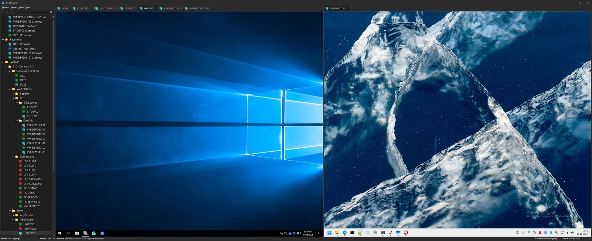
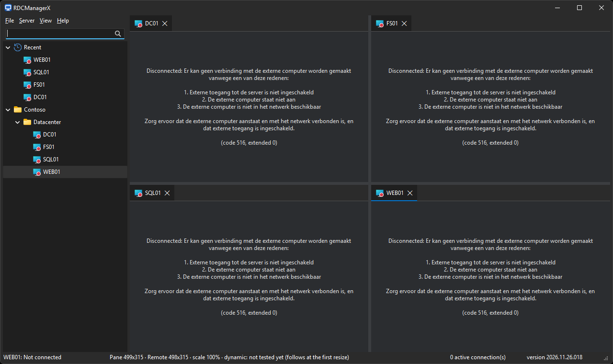
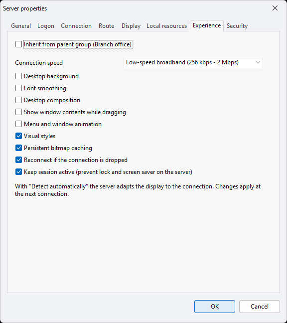
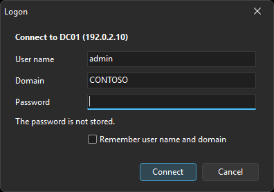
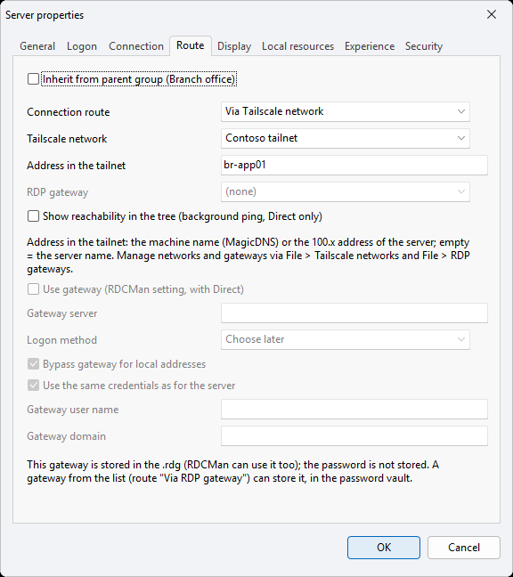
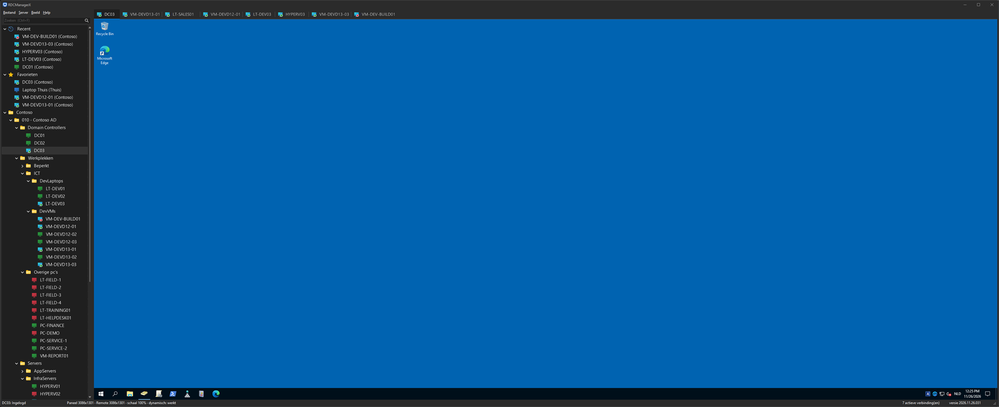

# RDCManagerX

**English** | [Nederlands](README.nl.md)

<p>
  <a href="https://www.embarcadero.com/products/delphi"></a>
  
  <a href="LICENSE"></a>
  <a href="https://mvanrijnen.github.io/RDCManagerX/"></a>
</p>

📖 **Manual (English / Dutch, HTML and PDF): [mvanrijnen.github.io/RDCManagerX](https://mvanrijnen.github.io/RDCManagerX/)**



An RDP connection manager in the style of Microsoft Remote Desktop Connection Manager (RDCMan). It reads and writes
RDCMan `.rdg` files and also has its own format, `.rdcx`.

The main difference from RDCMan is **dynamic resolution**: the remote session follows the size of the window.
RDCManagerX also has a **multi-view** (split screen with several sessions side by side), a password vault,
Wake-on-LAN, an optional **reachability check** in the tree, and routes via **Tailscale** or an **RD Gateway**.

Windows, 64-bit. Built with Delphi 12.

> [!NOTE]
> The user interface is available in English and Dutch (**File > Options > Language**; by default it follows the
> Windows display language). Menu paths below are given in English, with the Dutch label in parentheses, e.g.
> **Properties > Route** (*Eigenschappen > Route*).

**Keywords:** Delphi, Delphi 12, VCL, Object Pascal, RDP, Remote Desktop, Remote Desktop Protocol, RDP client,
RDP manager, RDCMan, Remote Desktop Connection Manager, RDCMan alternative, mstsc, mstscax, RD Gateway,
RDP Gateway, Remote Desktop Gateway, Tailscale, tsnet, WireGuard, dynamic resolution, multi-view, split screen,
Wake-on-LAN, Windows.

---

## Multi-view (split screen)

Work with several sessions at the same time: the session area can be split into a grid of panes, each with its own
tabs. Choose a layout in the **View** menu (*Beeld*):



- quick choices: 1 pane, 2/3/4 side by side, 2 stacked, 2×2, 3×2 and 4×2;
- **Custom…** (*Aangepast…*): any grid up to 6 columns × 3 rows;
- **Distribute evenly** (*Gelijk verdelen*) resets the splitters.

How it works:

- **Every pane has its own tab bar.** Drag a tab to another pane (or use the tab menu *Move to next pane*) to show
  that session there; drag within a tab bar to change the order.
- **Splitters** between the panes can be dragged; the sizes are remembered.
- **Dynamic resolution per pane:** each session follows the size of its own pane, also while you drag a splitter.
- **Connect a whole group** (*Server > Connect all servers*): the sessions are spread over the panes, with the
  credentials asked only once.
- Clicking a session or an empty pane makes it the active pane (accent line under its tab bar); new connections open
  there.
- A session can also go to a **separate window** or **full screen** (tab menu) and back, without reconnecting.

The layout (grid and splitter positions) is stored in the app settings, not in the connection file.

---

## Experience

The *Experience* tab (per server or group, inherited like every other setting) has the options of the mstsc Experience
tab: connection speed (choosing one sets the check boxes as mstsc does), desktop background, font smoothing, desktop
composition, window contents while dragging, animations, visual styles, persistent bitmap caching and automatic
reconnect. On top of that, **Keep session active** sends a tiny mouse movement to the session now and then while you
are not working in it, so the server does not lock or start its screen saver.



## Active Directory

A group can be linked to an AD OU (**Properties > Active Directory**, for example
`OU=Computers,DC=contoso,DC=com`). **Server > Refresh from Active Directory** then fills the group with the computers
in that OU, with sub-OUs as subgroups (only OUs that contain computers; or flat), using your own Windows account (signed and sealed LDAP, read only).
The computers become normal servers in the file, so the settings of the group apply to them, and their own settings
and favorites survive a refresh. Computers that are gone from AD are removed (not while a session is open); servers
you added yourself stay. Optionally the group refreshes when the file is opened. The link itself does not inherit.
The first query of a domain controller + OU asks for confirmation once per PC, because a file from someone else could
point at a foreign LDAP server.

## Logon

The password is asked at every connect, unless it is remembered in the password vault (*Remember passwords* in
Options, off by default; the check box in the prompt is never ticked by itself). **Remember user name and domain** is
separate from that: it stores the name with the server in the file (with the group when connecting a group), as on
the *Logon* tab, never the password.



## Connection routes

For each server or group you choose how RDCManagerX reaches the server: **Properties > Route**
(*Eigenschappen > Route*). Like the other settings, the route is inherited from the parent group.

| Route | What happens |
|---|---|
| **Direct** (default) | The usual behaviour. The settings on the *Gateway* tab (RDCMan-compatible) still apply. |
| **Via Tailscale network** | RDCManagerX itself temporarily becomes a device in your tailnet and sends only its own RDP traffic through it. Tailscale does not need to be installed on this PC. ⚠️ **Only safe with an ACL in your tailnet** (see [Tailscale](#tailscale)). |
| **Via RDP gateway** | Connect through a Microsoft RD Gateway from the file's gateway list. ⚠️ **Not tested yet.** |



The **definitions** of networks and gateways belong to the file. For an `.rdg` they are stored in the sidecar
`<file>.rdg.rdcx.json`, for an `.rdcx` in the file itself. The `.rdg` file therefore stays unchanged and RDCMan can
keep opening it.

**Secrets are never stored in the file.** An auth key, a tailnet node key and a gateway password are stored only in
the **password vault on this PC**. The vault is encrypted with your master password (AES-256-GCM, PBKDF2 with
600,000 iterations) and additionally with DPAPI in Windows Credential Manager. This requires *Remember passwords*
(*Wachtwoorden onthouden*) to be enabled under **File > Options** (*Bestand > Opties*).

If you take a file to another PC, the definitions go with it, but the secrets do not. On that PC you enter the auth
key or password once more, or you log in through the browser.

---

## Reachability and status



RDCManagerX can check in the background whether servers are reachable. This is **off** by default. You turn it on
for a file, group or server: **Properties > Route > Show reachability in the tree** (*Bereikbaarheid tonen in de
boom*). Clear the inherit checkbox first. Groups and servers below inherit the setting.

How the check works:

1. RDCManagerX sends a ping (ICMP, no administrator rights needed). If there is no reply, it tries a short TCP
   connection to the RDP port, because Windows often blocks ping.
2. If the server is reachable, RDCManagerX asks for the computer name at that address via NetBIOS (UDP 137, like
   `nbtstat -A`). If the name does not match, the DNS record probably points to a different device. If nothing
   answers via NetBIOS, or the server was entered as an IP address, this step is skipped.

All servers are checked in parallel without slowing down the app. The interval is 30 seconds by default and can be
set under **File > Options** (5 to 3600 seconds). Only servers with route **Direct** are checked: servers behind
Tailscale or a gateway cannot be reached directly from this PC. IPv4 only.

### What you see

A server without an open session gets a coloured icon in the tree:

| Colour | Meaning |
|---|---|
| Blue | Reachability is not checked, or the first check is still running |
| Green | Reachable |
| Red | Not reachable |
| Orange | Reachable, but a different computer answers at that address: the DNS record is probably stale |

A server with a session keeps its normal icon with a coloured dot: orange means connecting, green connected, red an
error.

- **Status bar:** for the selected server it shows e.g. *"dc01 is online (3 ms)"* or *"dc01 is niet bereikbaar
  (sinds 14:05)"* (not reachable since 14:05).
- **Tree tooltip:** for a server it shows the session state, the reachability (with address and response time), when
  it was last reachable, the last check and the comment. For a group it shows how many servers are reachable.

Orange is usually caused by a stale DNS record: the address was handed out by DHCP to another device, but the old
record is still in DNS. Delete the old record and enable DNS scavenging.

---

## Tailscale

> [!CAUTION]
> **Set up an ACL in your tailnet before you use RDP via Tailscale.** RDCManagerX cannot check this for you (the ACL
> lives in the Tailscale admin console), but without an ACL this route is not safe.
>
> Tailscale's default policy **allows everything**: every device in your tailnet may reach every other device, on
> every port. If you open RDP to Tailscale without an ACL, **any** device in your tailnet (an old phone, a shared
> laptop, a compromised device) can RDP to your PC. Only the Windows password stands in the way.
>
> Restrict RDP with an ACL to the RDCManagerX node(s) and the target PCs, remove the allow-all rule, and verify it
> with a `tests` block. See [Restricting access with an ACL](#restricting-access-with-an-acl).

### How it works

- **`tsbridge.dll`** is embedded in `RDCManagerX.exe` (compressed); only the exe needs to be distributed. On first
  use RDCManagerX extracts it to `%LOCALAPPDATA%\RDCManagerX\bin\` and loads it from there after verifying its
  checksum. (Loading directly from memory is not reliable with a Go DLL, and security software treats it as malware
  behaviour.) It is a Go library based on `tailscale.com/tsnet` and runs entirely in user space. No TUN driver,
  installation or administrator rights are needed.
- **One node starts per network**, as soon as the first session using that network connects. The network shuts down
  when the last tab using it is closed, or when you exit the app.
- **Each session gets a local forward**, e.g. `127.0.0.2:51234` → `home-pc:3389` in the tailnet. The RDP client
  connects to that. Tab, tree and messages still show the real server name.
  - The local address is deliberately not `127.0.0.1`, because the RDP client may refuse connections to its own
    loopback. It can be set per network.
  - The forward stays in place as long as the tab is open, so *Reconnect* and RDP's automatic reconnect keep working.
- **The target address** is the server's MagicDNS name or 100.x address. By default it is the server's host name in
  RDCManagerX; you can override it with *Address in the tailnet* (*Adres in het tailnet*) on the Route tab. The port
  comes from the *Connection* tab (default 3389).
- **Ephemeral** (on by default): the node disappears from your tailnet after exit and nothing is stored on disk.
- **Non-ephemeral:** the node keys are stored in
  `%LOCALAPPDATA%\RDCManagerX\tailscale\<network-id>\state\state.dpapi`. They are encrypted with a key that exists
  only in the password vault (AES-256-GCM), with DPAPI on top. You only need to log in once. If you turn off
  *Remember passwords* or empty the vault, that key is gone and you log in again.
- **Without an auth key** RDCManagerX opens the Tailscale login page in your browser.

### Adding a network

**File > Tailscale networks… > New** (*Bestand > Tailscale-netwerken… > Nieuw*):

| Field | Meaning |
|---|---|
| Name | E.g. "Home" or "Customer X". You pick the network by this name in the route. |
| Name in the tailnet | The name under which RDCManagerX appears as a device in your tailnet. Empty means `rdpclient-<computername>`. |
| Auth key | `tskey-auth-…`, optional. Empty means logging in through the browser. |
| Ephemeral | See above. Without an auth key it is better to turn this off, otherwise you log in at every start. |
| Control URL | Empty means Tailscale itself. For Headscale or another self-hosted control server, enter its URL. |
| Local address | `127.0.0.2` by default. Must be an address in 127.0.0.0/8. |

**Test connection** (*Test verbinding*) starts the network, shows the tailnet address and shuts it down again.

### Creating an auth key

In the Tailscale admin console go to **Settings > Keys > Generate auth key**:

- **Reusable**, so the same key works on several PCs and at every start;
- **Ephemeral**, so the node disappears when RDCManagerX stops;
- **Pre-approved**, if device approval is enabled;
- **Tags**, e.g. `tag:rdpclient`. This lets you restrict access with the ACL below.

**Auth keys expire**, after 90 days by default. After that, connecting fails with an error about an invalid or
expired key. Create a new one and enter it under Tailscale networks.

### Restricting access with an ACL

> [!WARNING]
> **Without an ACL, RDP via Tailscale is not safe.** Tailscale's default policy allows everything: every device may
> reach every other device. An ACL makes sure only the RDCManagerX node may RDP to the target PCs, and nobody else.

Set this up under **Access controls** in the admin console. Give the target PCs the tag `tag:rdpserver` (admin
console, device > *Edit ACL tags*) and use an auth key with the tag `tag:rdpclient` for RDCManagerX:

```json
{
  "tagOwners": {
    "tag:rdpclient": ["autogroup:admin"],
    "tag:rdpserver": ["autogroup:admin"]
  },
  "grants": [
    { "src": ["tag:rdpclient"], "dst": ["tag:rdpserver"], "ip": ["tcp:3389"] }
  ],
  "tests": [
    { "src": "tag:rdpclient", "accept": ["tag:rdpserver:3389"], "deny": ["tag:rdpserver:22", "tag:rdpserver:445"] }
  ]
}
```

Then check:

- **The allow-all rule is gone.** There must be no grant or ACL left with `"src": ["*"]` and `"dst": ["*"]` (or
  `"*:*"`). As long as it is there, the rule above adds nothing.
- **The `tests` block passes.** The admin console refuses to save if the rules behave differently from what the
  tests expect, so you notice a mistake right away.
- **Your own devices.** A tagged device no longer belongs to your user account. If you want to reach the target PCs
  (or each other) from your own devices as well, give them their own rule, as narrow as possible.

Prefer a fixed address over a tag? Then use `"hosts": { "home-pc": "100.x.y.z" }` and `"dst": ["home-pc"]`.

**Secure the tailnet itself too:**

- **MFA** on the account you use to log in to Tailscale (Apple, Google, Microsoft, GitHub…). That account is the key
  to your whole tailnet.
- **Device approval** (*Settings > Device management*): a new device only joins the tailnet after you approve it.
  Use auth keys with *Pre-approved* in that case.
- **Ephemeral, tagged auth keys** with an expiry date (see above).

### On the target PC

- **Tailscale must be running**, installed normally, and Remote Desktop must be enabled.
- **Turn on "Run unattended"** in the Tailscale menu on the target PC. Otherwise Tailscale only connects once someone
  has logged on locally, so after a restart the PC cannot be reached until you log on there. You can still switch it
  off: *Disconnect* in the Tailscale menu (or `tailscale down`) takes the PC off the tailnet until you choose
  *Connect* again; *Exit* only closes the tray icon and keeps the connection; stopping the *Tailscale* service stops
  it completely.
- **Windows Firewall must allow RDP from the Tailscale adapter, and only there.** The built-in *Remote Desktop*
  rule often only applies to the *Private/Domain* profile. Allow TCP 3389 from `100.64.0.0/10` on the adapter
  `Tailscale` (PowerShell as administrator):

  ```powershell
  New-NetFirewallRule -DisplayName "RDP via Tailscale" -Direction Inbound -Protocol TCP -LocalPort 3389 -RemoteAddress 100.64.0.0/10 -InterfaceAlias Tailscale -Action Allow
  ```

  - Without `-InterfaceAlias` the rule applies to every adapter. `100.64.0.0/10` is also the CGNAT range some ISPs
    use.
  - Windows binds the rule to that specific adapter. If you reinstall Tailscale, run the command again.
  - Check that the built-in *Remote Desktop* rules are not enabled for the *Public* profile:
    `Get-NetFirewallRule -Group '@FirewallAPI.dll,-28752' | Select-Object DisplayName, Enabled, Profile`
  - Test from a device outside the tailnet: `Test-NetConnection <ip-of-target-pc> -Port 3389` should return
    `TcpTestSucceeded : False`, unless you deliberately allow RDP within the LAN.
- **NLA on** (*Settings > System > Remote Desktop > Require Network Level Authentication*), so no logon screen is
  shown until a valid logon.
- **Account lockout on**, so passwords cannot be guessed endlessly. Check with `net accounts`. If the threshold is
  *Never*: `net accounts /lockoutthreshold:10 /lockoutduration:15 /lockoutwindow:15`.
- **A strong password**, and only the necessary accounts in *Administrators* and *Remote Desktop Users*.

### Certificate and logon

The RDP client connects to `127.0.0.2`, not to the real server name. That has two consequences:

- **The server certificate** does not match `127.0.0.2`.
  - With *Server authentication: Warn* (Security tab) you get the familiar certificate warning, which you can accept.
  - With *Do not connect if authentication fails* the connection fails.
  - The ActiveX control has no property to specify the expected server name (`AuthenticationServiceClass` is only
    the SPN service class).
- **Kerberos does not work**, so NLA/CredSSP falls back to **NTLM**. That works with local accounts and Microsoft
  accounts. In a domain where NTLM is blocked, the Tailscale route does not work.

### Network behaviour

- **Direct connection:** Tailscale first tries a direct UDP connection (WireGuard).
- **UDP blocked** (e.g. on a corporate network): Tailscale automatically falls back to a **DERP relay over
  HTTPS/443**. That works, but is slower.
- **A TLS-inspecting corporate proxy** can break the connection to the control server or DERP. You then see a
  timeout or a certificate error in *Test connection*.

### Security

- **The tunnel is for RDCManagerX only.**
  - The local port listens only on a loopback address (127.x), never on the network. Any other local address from a
    file is ignored.
  - The port is claimed exclusively, so another program cannot hijack it.
  - Only connections from the RDCManagerX process itself are forwarded; other programs on the PC are refused.
- **Tailnet only.** The target is resolved among the devices in the tailnet (MagicDNS name or 100.x address, or an
  address in an approved subnet route). A name or address outside the tailnet is refused; RDCManagerX never silently
  connects outside Tailscale. An exit node does not count.
- **MagicDNS names of your own tailnet only.** The name a device gives itself does not count by default (otherwise a
  foreign device calling itself `srv` could take over when the real server is gone or renamed), and devices shared
  with you from another tailnet are never chosen. Both can be allowed per network in *File > Tailscale networks*;
  that choice is stored on this PC, not in the file. The connection status shows which device was chosen, e.g.
  `srv01.tail1234.ts.net (100.64.0.10)`.
- **Secrets belong to one server.** A stored auth key and node key belong to the control server they were entered
  for, a gateway password to that gateway (host and port).
  - A file that points a network or gateway at a different server therefore does not get the secret.
  - If you change the control URL or the gateway server, the stored secret is deleted (after confirmation).
- **Control URL over https only** (http only to localhost); otherwise the auth key could be intercepted in transit.
- **Login page over https only.** Only an https address is opened in the browser; any other "login address" from a
  control server is refused.
- **DLL checksum.** RDCManagerX only loads the `tsbridge.dll` whose checksum (SHA-256) is pinned in the exe. A
  replaced or different version is refused and connecting via Tailscale is then disabled.

**What you need to do or know yourself:**
- **Only open files you trust.** As with RDCMan, a file can define a server, gateway or tailnet that points to a
  foreign server. Your stored secrets do not go there, but whatever you type in when connecting does.
- **Certificate warning via Tailscale:** the connection up to the server is encrypted and authenticated by
  Tailscale (WireGuard, by device identity). The warning only appears because the name `127.0.0.2` is not in the
  certificate.
- **Secrets in memory:** while in use, an auth key and passwords are inevitably in the program's memory.
  RDCManagerX wipes its own copies, but the Go runtime in `tsbridge.dll` cannot guarantee that. There is no
  protection against someone who can read the memory of your running session; that applies to any program.

### Troubleshooting

Start RDCManagerX with `/debuglog`. Two logs are then written to `%LOCALAPPDATA%\RDCManagerX\`:

- `debug.log` (RDCManagerX);
- `tsbridge-<network-id>.log` (Tailscale).

Auth keys are always filtered out of the logs. No logs are ever sent to Tailscale (`TS_NO_LOGS_NO_SUPPORT`).

**Black screen after being idle, session still connected** (reconnecting fixes it): usually the target PC - its screen
saver or display power-off together with the WDDM display driver for RDP. On the target PC, check with
[`Tools/rdp-check.ps1`](Tools/rdp-check.ps1) and fix with [`Tools/rdp-blackscreen-fix.ps1`](Tools/rdp-blackscreen-fix.ps1)
(as administrator; backup first, `-Undo` restores; restart afterwards). Run it with
`powershell -NoProfile -ExecutionPolicy Bypass -File rdp-blackscreen-fix.ps1`.

---

## RD Gateway

> [!IMPORTANT]
> **The RD Gateway route has not been tested yet** against a real RD Gateway. It is built according to the
> Remote Desktop ActiveX documentation, but expect rough edges. Feedback and issue reports are welcome.

**File > RDP gateways… > New** (*Bestand > RDP-gateways… > Nieuw*):

| Field | Meaning |
|---|---|
| Gateway server / Port | E.g. `rdg.example.com`. An empty port means 443. |
| Usage | *Always*, *Detect automatically*, or *Always except for local addresses*. |
| Credentials | *Same as for the session*, *Own* (user, domain and password; the password in the vault), *Ask when connecting*, or *Smart card*. |
| Logon method | *Password (NTLM)*, *Smart card* or *Automatic*. |

Then choose **Properties > Route > Via RDP gateway** for each server or group.

- **Own credentials without a stored password:** Windows asks for it itself when connecting.
- **Client without gateway support:** if the Remote Desktop client on the PC does not support a gateway
  (`GatewayIsSupported`), you get an error and it does not silently connect directly.
- **Route Direct:** the gateway settings in the `.rdg` (*Gateway* tab, RDCMan-compatible) keep working unchanged.

---

## Installing

Unzip the release into a folder of its own, for example `%LOCALAPPDATA%\Programs\RDCManagerX` or `C:\Program Files\RDCManagerX`, and start it from there, not from the Downloads folder: Windows looks for some DLLs next to the exe first, and Downloads may contain files you did not mean to run. The app warns when it is started from Downloads.

## Building

With Delphi 12 (Win64):

```
call "C:\Program Files (x86)\Embarcadero\Studio\23.0\bin\rsvars.bat"
msbuild RDCManagerX.dproj /t:Build /p:Config=Release /p:Platform=Win64
```

A fresh clone builds with Delphi alone: the Tailscale bridge DLL, the English texts and the manual are committed and
embedded in the exe. **[BUILDING.md](BUILDING.md)** explains the tests, the Tailscale bridge (`tsbridge.dll`, Go,
reproducible build and hash check), the translation, the manual and the release package.

---

## Built with Delphi

RDCManagerX is written in [Delphi](https://www.embarcadero.com/products/delphi) 12 Athens by Embarcadero (Object
Pascal, VCL): one native Win64 exe, no runtime and no installer. Only the optional Tailscale bridge is a small Go
library, embedded in the exe. See [BUILDING.md](BUILDING.md) to build it yourself.

---

## Background

The idea is derived from [Remote Desktop Connection Manager (RDCMan)](https://learn.microsoft.com/sysinternals/downloads/rdcman)
by Microsoft Sysinternals: the layout with a tree of groups and servers, inheritable settings and the `.rdg` file
format. It is an independent implementation: no RDCMan code was used. RDCManagerX is not affiliated with Microsoft
or Sysinternals.

Developed by Maurits van Rijnen with help from [Claude](https://www.anthropic.com/claude) (Anthropic) via
[Claude Code](https://claude.com/claude-code). Claude is credited as co-author in the commits.
