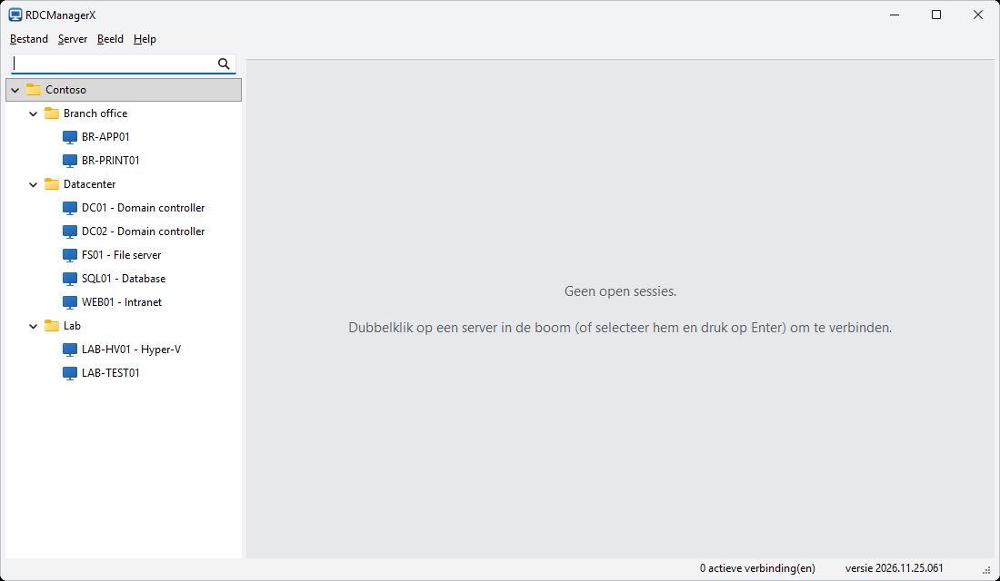
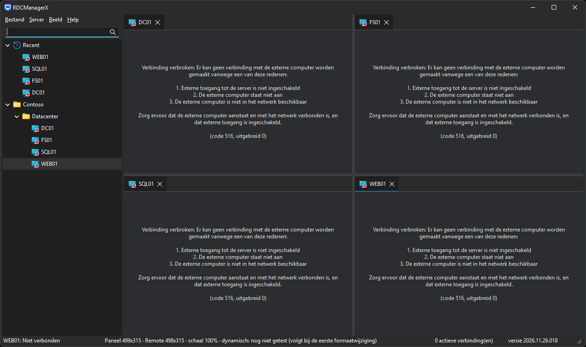
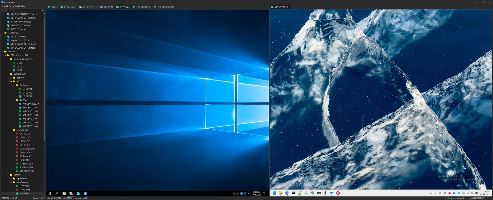
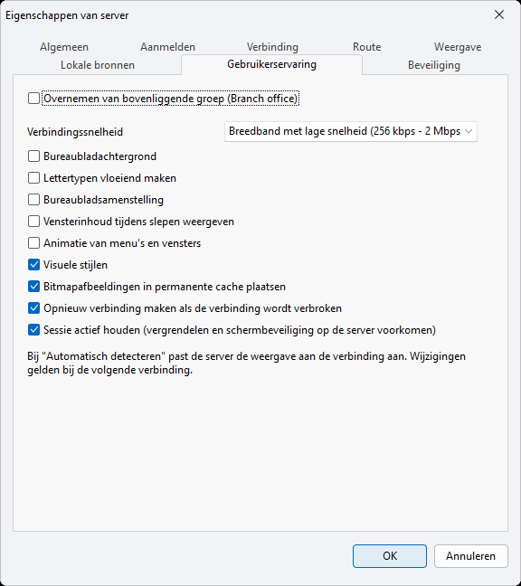
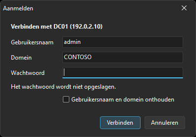
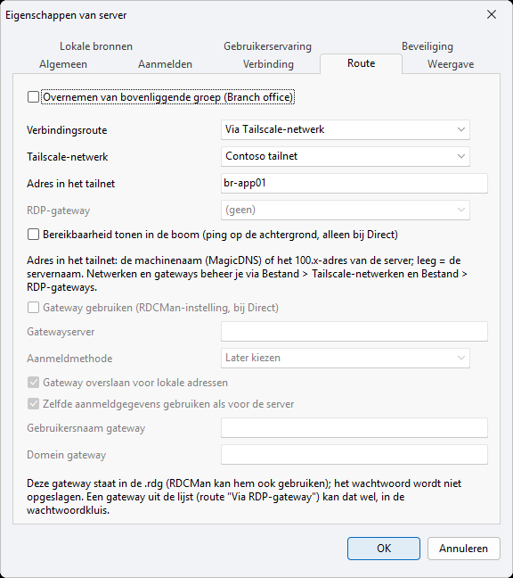
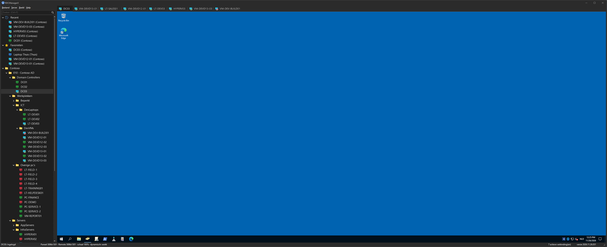

# RDCManagerX

[English](README.md) | **Nederlands**

<p>
  <a href="https://www.embarcadero.com/products/delphi"></a>
  
  <a href="https://github.com/mvanrijnen/RDCManagerX/releases/latest"></a>
  <a href="LICENSE"></a>
  <a href="https://mvanrijnen.github.io/RDCManagerX/nl/"></a>
</p>

📖 **Handleiding (Nederlands / Engels, HTML en PDF): [mvanrijnen.github.io/RDCManagerX](https://mvanrijnen.github.io/RDCManagerX/nl/)**



Een RDP-verbindingsbeheerder in de stijl van Microsoft Remote Desktop Connection Manager (RDCMan). Het programma
leest en schrijft `.rdg`-bestanden van RDCMan en heeft een eigen formaat, `.rdcx`.

Het belangrijkste verschil met RDCMan is **dynamische resolutie**: de sessie past zich aan de venstergrootte aan.
Daarnaast heeft RDCManagerX een **multi-view** (gesplitst scherm met meerdere sessies naast elkaar), een
wachtwoordkluis, Wake-on-LAN, een optionele **bereikbaarheidscontrole** in de boom, en routes via **Tailscale** of een
**RD Gateway**.

Windows, 64-bit. Gebouwd met Delphi 12.

**Trefwoorden:** Delphi, Delphi 12, VCL, Object Pascal, RDP, Remote Desktop, Remote Desktop Protocol, RDP client,
RDP manager, RDCMan, Remote Desktop Connection Manager, RDCMan alternative, mstsc, mstscax, RD Gateway,
RDP Gateway, Remote Desktop Gateway, Tailscale, tsnet, WireGuard, dynamic resolution, multi-view, split screen,
Wake-on-LAN, Windows.

---

## Multi-view (gesplitst scherm)

Werk met meerdere sessies tegelijk: het sessiegebied kan worden verdeeld in een raster van vakken, elk met eigen tabs.
Kies een indeling in het menu **Beeld**:



In de praktijk: twee vakken met live sessies naast een Active Directory-groep (namen geanonimiseerd):



- snelle keuzes: 1 vak, 2/3/4 naast elkaar, 2 boven elkaar, 2×2, 3×2 en 4×2;
- **Aangepast…**: elk raster tot 6 kolommen × 3 rijen;
- **Gelijk verdelen** zet de splitters terug.

Zo werkt het:

- **Elk vak heeft een eigen tabbalk.** Sleep een tab naar een ander vak (of kies in het tabmenu *Naar het volgende
  vak verplaatsen*) om die sessie daar te tonen; sleep binnen een tabbalk om de volgorde te wijzigen.
- **Splitters** tussen de vakken zijn versleepbaar; de maten worden onthouden.
- **Dynamische resolutie per vak:** elke sessie volgt de grootte van haar eigen vak, ook tijdens het slepen van een
  splitter.
- **Een hele groep verbinden** (*Server > Alle servers verbinden*): de sessies worden over de vakken verdeeld en de
  aanmeldgegevens worden één keer gevraagd.
- Klik op een sessie of een leeg vak om het actief te maken (accentlijn onder de tabbalk); nieuwe verbindingen openen
  daar.
- Een sessie kan ook naar een **eigen venster** of **volledig scherm** (tabmenu) en terug, zonder opnieuw te verbinden.

De indeling (raster en splitterposities) staat in de app-instellingen, niet in het verbindingsbestand.

---

## Gebruikerservaring

Het tabblad *Gebruikerservaring* (per server of groep, erft zoals alle instellingen) heeft de opties van het tabblad
Ervaring in mstsc: verbindingssnelheid (een keuze zet de vinkjes zoals mstsc dat doet), bureaubladachtergrond,
vloeiende lettertypen, bureaubladsamenstelling, vensterinhoud tijdens slepen, animaties, visuele stijlen,
bitmapcache en automatisch opnieuw verbinden. Daarnaast stuurt **Sessie actief houden** af en toe een kleine
muisbeweging naar de sessie zolang je er niet in werkt, zodat de server niet vergrendelt of de schermbeveiliging start.



## Active Directory

Een groep kun je koppelen aan een AD-OU (**Eigenschappen > Active Directory**, bijvoorbeeld
`OU=Computers,DC=contoso,DC=com`). **Server > Verversen vanuit Active Directory** vult de groep dan met de computers in
die OU, met sub-OU's als subgroepen (alleen OU's met computers erin; of plat), met je eigen Windows-account (ondertekende en versleutelde LDAP, alleen
lezen). De computers worden gewone servers in het bestand: de instellingen van de groep gelden voor hen, en hun eigen
instellingen en favorieten blijven bij verversen bewaard. Computers die uit AD verdwenen zijn worden verwijderd (niet
zolang er een sessie open is); zelf toegevoegde servers blijven staan. Optioneel ververst de groep bij het openen van
het bestand. De koppeling zelf erft niet over. De eerste keer dat een domeincontroller + OU bevraagd wordt, vraagt de
app per pc om bevestiging, omdat een bestand van iemand anders naar een vreemde LDAP-server kan wijzen.

## Aanmelden

Het wachtwoord wordt bij elke verbinding gevraagd, tenzij het onthouden is in de wachtwoordkluis (*Wachtwoorden
onthouden* in Opties, standaard uit; het vinkje in de aanmeldvraag staat nooit vanzelf aan). **Gebruikersnaam en domein
onthouden** staat daar los van: het zet de naam bij de server in het bestand (bij een groep verbinden: bij de groep),
zoals op het tabblad *Aanmelden*, nooit het wachtwoord.



## Verbindingsroutes

Per server of groep stel je in hoe RDCManagerX de server bereikt: **Eigenschappen > Route**. Net als de andere
instellingen erft de route van de bovenliggende groep.

| Route | Wat er gebeurt |
|---|---|
| **Direct** (standaard) | Hetzelfde gedrag als vroeger. Ook de instellingen op de tab *Gateway* (RDCMan-compatibel) blijven gelden. |
| **Via Tailscale-netwerk** | RDCManagerX wordt zelf, tijdelijk, een apparaat in je tailnet en stuurt alleen zijn eigen RDP-verkeer daarover. Tailscale hoeft op deze pc niet geïnstalleerd te zijn. ⚠️ **Alleen veilig met een ACL in je tailnet** (zie [Tailscale](#tailscale)). |
| **Via RDP-gateway** | Verbinden via een Microsoft RD Gateway uit de lijst van het bestand. ⚠️ **Nog niet getest.** |



De **definities** van netwerken en gateways horen bij het bestand. Bij een `.rdg` staan ze in de sidecar
`<bestand>.rdg.rdcx.json`, bij een `.rdcx` in het bestand zelf. Het `.rdg`-bestand blijft daardoor ongewijzigd en
RDCMan kan het gewoon blijven openen.

**Geheimen staan nooit in het bestand.** Een auth key, de sleutel van een tailnet-node en een gateway-wachtwoord
staan alleen in de **wachtwoordkluis van deze pc**. Die is versleuteld met je hoofdwachtwoord (AES-256-GCM,
PBKDF2 met 600.000 rondes) en daarbovenop met DPAPI in Windows Referentiebeheer. Daarvoor moet *Wachtwoorden
onthouden* aan staan (Bestand > Opties).

Neem je een bestand mee naar een andere pc, dan gaan de definities mee, maar de geheimen niet. Op die pc vul je de
auth key of het wachtwoord één keer opnieuw in, of je logt in via de browser.

---

## Bereikbaarheid en status



RDCManagerX kan op de achtergrond controleren of servers bereikbaar zijn. Dit staat standaard **uit**. Je zet het aan
op een bestand, groep of server: **Eigenschappen > Route > Bereikbaarheid tonen in de boom**. Zet daarvoor eerst het
overerf-vinkje uit. Groepen en servers eronder erven de instelling.

Zo werkt de controle:

1. RDCManagerX stuurt een ping (ICMP, er zijn geen beheerdersrechten nodig). Komt er geen antwoord, dan probeert het
   een korte TCP-verbinding met de RDP-poort, omdat Windows ping vaak blokkeert.
2. Is de server bereikbaar, dan vraagt RDCManagerX via NetBIOS (UDP 137, zoals `nbtstat -A`) de computernaam op dat
   adres op. Komt die niet overeen, dan wijst het DNS-record waarschijnlijk naar een ander apparaat. Antwoordt er
   niemand via NetBIOS, of is de server met een IP-adres ingevoerd, dan wordt deze stap overgeslagen.

Alle servers worden tegelijk gecontroleerd, zonder dat de app daar trager van wordt. Het interval is standaard 30
seconden en stel je in bij **Bestand > Opties** (5 tot 3600 seconden). Alleen servers met route **Direct** worden
gecontroleerd: servers achter Tailscale of een gateway zijn vanaf deze pc niet rechtstreeks te bereiken. Het gaat
alleen om IPv4.

### Wat je ziet

Een server zonder open sessie krijgt een gekleurd icoon in de boom:

| Kleur | Betekenis |
|---|---|
| Blauw | Bereikbaarheid wordt niet gecontroleerd, of de eerste controle loopt nog |
| Groen | Bereikbaar |
| Rood | Niet bereikbaar |
| Oranje | Bereikbaar, maar op dat adres antwoordt een andere computer: het DNS-record is waarschijnlijk verouderd |

Een server met een sessie houdt het gewone icoon met een gekleurde stip: oranje betekent verbinden, groen verbonden en
rood een fout.

- **Statusbalk:** bij een geselecteerde server staat bijvoorbeeld *"dc01 is online (3 ms)"* of *"dc01 is niet
  bereikbaar (sinds 14:05)"*.
- **Tooltip in de boom:** bij een server staan de sessiestatus, de bereikbaarheid (met adres en reactietijd), wanneer
  hij voor het laatst bereikbaar was, de laatste controle en de opmerking. Bij een groep staat hoeveel servers
  bereikbaar zijn.

Oranje komt meestal door een verouderd DNS-record: het adres is via DHCP aan een ander apparaat uitgedeeld, maar het
oude record staat nog in de DNS. Verwijder het oude record en zet DNS-scavenging aan.

---

## Tailscale

> [!CAUTION]
> **Stel eerst een ACL in je tailnet in voordat je RDP via Tailscale gebruikt.** RDCManagerX kan dat niet voor je
> controleren (de ACL staat in de adminconsole van Tailscale), maar zonder ACL is deze route niet veilig.
>
> Het standaardbeleid van Tailscale staat **álles toe**: elk apparaat in je tailnet mag elk ander apparaat bereiken,
> op elke poort. Zet je RDP open voor Tailscale zonder ACL, dan kan **elk** apparaat in je tailnet (een oude
> telefoon, een gedeelde laptop, een gehackt apparaat) RDP doen naar je pc. Alleen het Windows-wachtwoord houdt
> het dan nog tegen.
>
> Beperk RDP met een ACL tot de RDCManagerX-node(s) en de doel-pc's, haal de regel weg die alles toestaat, en
> controleer het met een `tests`-blok. Zie [Toegang beperken met een ACL](#toegang-beperken-met-een-acl).

### Hoe het werkt

- **`tsbridge.dll`** zit ingebouwd in `RDCManagerX.exe` (gecomprimeerd); alleen de exe hoeft verspreid te worden.
  Bij het eerste gebruik pakt RDCManagerX hem uit naar `%LOCALAPPDATA%\RDCManagerX\bin\` en laadt hem daar, na
  controle van de controlesom. (Laden rechtstreeks uit het geheugen kan niet betrouwbaar met een Go-DLL, en
  beveiligingssoftware ziet dat als malware-gedrag.) Het is een Go-bibliotheek op basis van `tailscale.com/tsnet` en
  draait volledig in userspace. Er is geen TUN-driver, installatie of beheerrecht nodig.
- **Per netwerk start één node**, zodra de eerste sessie die het netwerk gebruikt verbindt. Het netwerk sluit weer
  als de laatste tab die het gebruikt dicht gaat, of als je de app afsluit.
- **Per sessie komt er een lokale doorverwijzing**, bijvoorbeeld `127.0.0.2:51234` → `thuis-pc:3389` in het
  tailnet. Daarmee verbindt de RDP-client. Tab, boom en meldingen tonen wel de echte servernaam.
  - Het lokale adres is bewust niet `127.0.0.1`, omdat de RDP-client verbindingen met de eigen loopback kan
    weigeren. Je stelt het per netwerk in.
  - De doorverwijzing blijft bestaan zolang de tab open is. Daardoor werken *Opnieuw verbinden* en het automatisch
    opnieuw verbinden van RDP gewoon.
- **Het doeladres** is de MagicDNS-naam of het 100.x-adres van de server. Standaard is dat de hostnaam van de server
  in RDCManagerX; afwijken kan via *Adres in het tailnet* op de tab Route. De poort komt van de tab *Verbinding*
  (standaard 3389).
- **Ephemeral** (standaard aan): de node verdwijnt uit je tailnet na het afsluiten en er wordt niets op schijf
  bewaard.
- **Niet-ephemeral:** de node-sleutels worden bewaard in
  `%LOCALAPPDATA%\RDCManagerX\tailscale\<netwerk-id>\state\state.dpapi`. Ze zijn versleuteld met een sleutel die
  alleen in de wachtwoordkluis staat (AES-256-GCM), met DPAPI daarbovenop. Inloggen hoeft dan maar één keer. Zet je
  *Wachtwoorden onthouden* uit of leeg je de kluis, dan is die sleutel weg en log je opnieuw in.
- **Zonder auth key** opent RDCManagerX de login-pagina van Tailscale in je browser.

### Netwerk toevoegen

**Bestand > Tailscale-netwerken… > Nieuw**:

| Veld | Betekenis |
|---|---|
| Naam | Bijv. "Thuis" of "Klant X". Je kiest het netwerk op deze naam bij de route. |
| Naam in het tailnet | De naam waaronder RDCManagerX als apparaat in je tailnet verschijnt. Leeg betekent `rdpclient-<computernaam>`. |
| Auth key | `tskey-auth-…`, optioneel. Leeg betekent inloggen via de browser. |
| Ephemeral | Zie hierboven. Zonder auth key zet je dit beter uit, anders log je bij elke start opnieuw in. |
| Control URL | Leeg is Tailscale zelf. Voor Headscale of een andere eigen control server vul je de URL in. |
| Lokaal adres | Standaard `127.0.0.2`. Moet een adres in 127.0.0.0/8 zijn. |

**Test verbinding** start het netwerk, toont het tailnet-adres en sluit het daarna weer.

### Auth key maken

Ga in de Tailscale-adminconsole naar **Settings > Keys > Generate auth key**:

- **Reusable**, zodat dezelfde key op meerdere pc's en bij elke start werkt;
- **Ephemeral**, zodat de node verdwijnt als RDCManagerX stopt;
- **Pre-approved**, als device approval aan staat;
- **Tags**, bijvoorbeeld `tag:rdpclient`. Daarmee beperk je de toegang via de ACL hieronder.

**Auth keys verlopen**, standaard na 90 dagen. Daarna krijg je bij het verbinden een foutmelding over een ongeldige
of verlopen key. Maak dan een nieuwe aan en vul die in bij Tailscale-netwerken.

### Toegang beperken met een ACL

> [!WARNING]
> **Zonder ACL is RDP via Tailscale niet veilig.** Het standaardbeleid van Tailscale staat álles toe: elk apparaat
> mag elk ander apparaat bereiken. Een ACL zorgt dat alleen de RDCManagerX-node RDP naar de doel-pc's mag, en verder
> niemand.

Stel dit in onder **Access controls** in de adminconsole. Geef de doel-pc's de tag `tag:rdpserver` (adminconsole,
apparaat > *Edit ACL tags*) en gebruik voor RDCManagerX een auth key met de tag `tag:rdpclient`:

```json
{
  "tagOwners": {
    "tag:rdpclient": ["autogroup:admin"],
    "tag:rdpserver": ["autogroup:admin"]
  },
  "grants": [
    { "src": ["tag:rdpclient"], "dst": ["tag:rdpserver"], "ip": ["tcp:3389"] }
  ],
  "tests": [
    { "src": "tag:rdpclient", "accept": ["tag:rdpserver:3389"], "deny": ["tag:rdpserver:22", "tag:rdpserver:445"] }
  ]
}
```

Controleer daarna:

- **De regel die alles toestaat is weg.** Er mag geen grant of ACL meer staan met `"src": ["*"]` en `"dst": ["*"]`
  (of `"*:*"`). Zolang die er nog staat, voegt de regel hierboven niets toe.
- **Het `tests`-blok klopt.** De adminconsole weigert het opslaan als de regels iets anders doen dan de tests
  verwachten. Zo merk je een fout meteen.
- **Je eigen apparaten.** Een getagd apparaat hoort niet meer bij je gebruikersaccount. Wil je vanaf je eigen
  apparaten ook bij de doel-pc's, of bij elkaar, dan geef je die een eigen, zo klein mogelijke regel.

Liever een vast adres dan een tag? Dan kan het ook met `"hosts": { "thuis-pc": "100.x.y.z" }` en `"dst": ["thuis-pc"]`.

**Beveilig ook het tailnet zelf:**

- **MFA** op het account waarmee je bij Tailscale inlogt (Apple, Google, Microsoft, GitHub…). Dat account is de
  sleutel tot je hele tailnet.
- **Device approval** (*Settings > Device management*): een nieuw apparaat komt pas in het tailnet als jij het
  goedkeurt. Gebruik dan auth keys met *Pre-approved*.
- **Ephemeral auth keys met een tag** en een vervaldatum (zie hierboven).

### Op de doel-pc

- **Tailscale moet draaien**, gewoon geïnstalleerd, en Extern bureaublad moet aan staan.
- **Zet "Run unattended" aan** in het Tailscale-menu op de doel-pc. Anders verbindt Tailscale pas als er iemand
  lokaal is aangemeld, en is de pc na een herstart onbereikbaar tot je daar inlogt. Uitzetten kan nog steeds:
  *Disconnect* in het Tailscale-menu (of `tailscale down`) haalt de pc uit het tailnet tot je weer *Connect* kiest;
  *Exit* sluit alleen het pictogram en houdt de verbinding; de service *Tailscale* stoppen zet hem helemaal uit.
- **De Windows Firewall moet RDP toestaan vanaf de Tailscale-adapter, en alleen daar.** De standaardregel
  *Extern bureaublad* geldt vaak alleen voor het profiel *Privé/Domein*. Sta TCP 3389 toe vanaf `100.64.0.0/10` op
  de adapter `Tailscale` (PowerShell als beheerder):

  ```powershell
  New-NetFirewallRule -DisplayName "RDP via Tailscale" -Direction Inbound -Protocol TCP -LocalPort 3389 -RemoteAddress 100.64.0.0/10 -InterfaceAlias Tailscale -Action Allow
  ```

  - Zonder `-InterfaceAlias` geldt de regel op elke adapter. `100.64.0.0/10` is ook de CGNAT-reeks die sommige
    providers gebruiken.
  - Windows koppelt de regel aan die specifieke adapter. Installeer je Tailscale opnieuw, voer het commando dan
    opnieuw uit.
  - Controleer dat de standaardregels *Extern bureaublad* niet aan staan voor het profiel *Openbaar*:
    `Get-NetFirewallRule -Group '@FirewallAPI.dll,-28752' | Select-Object DisplayName, Enabled, Profile`
  - Test vanaf een apparaat buiten het tailnet: `Test-NetConnection <ip-van-doel-pc> -Port 3389` hoort
    `TcpTestSucceeded : False` te geven, tenzij je RDP binnen het LAN bewust toestaat.
- **NLA aan** (*Instellingen > Systeem > Extern bureaublad > Netwerkverificatie vereisen*), zodat er pas een
  aanmeldscherm komt na een geldige aanmelding.
- **Accountvergrendeling aan**, zodat wachtwoorden niet eindeloos geprobeerd kunnen worden. Controleer met
  `net accounts`. Staat de drempel op *Never*:
  `net accounts /lockoutthreshold:10 /lockoutduration:15 /lockoutwindow:15`.
- **Een sterk wachtwoord**, en alleen de nodige accounts in *Administrators* en *Extern bureaublad-gebruikers*.

### Certificaat en aanmelding

De RDP-client verbindt met `127.0.0.2` en niet met de echte servernaam. Dat heeft twee gevolgen:

- **Het servercertificaat** past niet bij `127.0.0.2`.
  - Bij *Serverauthenticatie: Waarschuwen* (tab Beveiliging) krijg je de bekende certificaatwaarschuwing, die je
    kunt accepteren.
  - Bij *Niet verbinden als verificatie mislukt* lukt de verbinding niet.
  - De ActiveX heeft geen eigenschap om de verwachte servernaam op te geven (`AuthenticationServiceClass` is alleen
    de SPN-serviceklasse).
- **Kerberos werkt niet**, dus NLA/CredSSP valt terug op **NTLM**. Met lokale accounts en Microsoft-accounts werkt
  dat. In een domein waar NTLM is geblokkeerd werkt de Tailscale-route niet.

### Netwerkgedrag

- **Rechtstreekse verbinding:** Tailscale probeert eerst een directe UDP-verbinding (WireGuard).
- **UDP geblokkeerd** (bijv. op een bedrijfsnetwerk): Tailscale valt automatisch terug op een **DERP-relay via
  HTTPS/443**. Dat werkt, maar is trager.
- **Een TLS-inspecterende bedrijfsproxy** kan de verbinding met de control server of DERP verstoren. Je ziet dan een
  time-out of een certificaatfout bij *Test verbinding*.

### Beveiliging

- **De tunnel is alleen voor RDCManagerX.**
  - De lokale poort luistert alleen op een loopback-adres (127.x), nooit op het netwerk. Een ander lokaal adres uit
    een bestand wordt genegeerd.
  - De poort wordt exclusief geclaimd, zodat een ander programma hem niet kan kapen.
  - Alleen verbindingen uit het RDCManagerX-proces zelf worden doorgestuurd; andere programma's op de pc worden
    geweigerd.
- **Alleen binnen het tailnet.** Het doel wordt opgezocht tussen de apparaten in het tailnet (MagicDNS-naam of
  100.x-adres, of een adres in een goedgekeurde subnet-route). Een naam of adres buiten het tailnet wordt geweigerd;
  RDCManagerX verbindt nooit stilletjes buiten Tailscale om. Een exit-node telt niet mee.
- **Alleen MagicDNS-namen van je eigen tailnet.** De naam die een apparaat zichzelf geeft telt standaard niet mee
  (anders kan een vreemd apparaat dat zich `srv` noemt het overnemen als de echte server weg of hernoemd is), en
  apparaten die vanuit een ander tailnet met je gedeeld zijn worden nooit gekozen. Beide kun je per netwerk toestaan
  in *Bestand > Tailscale-netwerken*; die keuze staat op deze pc, niet in het bestand. De verbindingsstatus toont welk
  apparaat gekozen is, bijv. `srv01.tail1234.ts.net (100.64.0.10)`.
- **Geheimen horen bij één server.** Een opgeslagen auth key en node-sleutel horen bij de control server waarvoor ze
  zijn ingevoerd, een gateway-wachtwoord bij die gateway (host en poort).
  - Een bestand dat een netwerk of gateway naar een andere server laat wijzen, krijgt het geheim dus niet.
  - Wijzig je de control URL of de gatewayserver, dan wordt het opgeslagen geheim gewist (met een vraag vooraf).
- **Control URL alleen via https** (http alleen naar localhost); anders kan de auth key onderweg worden onderschept.
- **Login-pagina alleen via https.** Alleen een https-adres wordt in de browser geopend; een ander "login-adres" van
  een control server wordt geweigerd.
- **Controlesom van de DLL.** RDCManagerX laadt alleen de `tsbridge.dll` waarvan de controlesom (SHA-256) in de exe
  is vastgelegd. Een vervangen of andere versie wordt geweigerd en verbinden via Tailscale is dan uitgeschakeld.

**Wat je zelf moet doen of weten:**
- **Open alleen bestanden die je vertrouwt.** Net als bij RDCMan kan een bestand een server, gateway of tailnet
  definiëren dat naar een vreemde server wijst. Jouw opgeslagen geheimen gaan daar niet heen, maar wat je bij het
  verbinden zelf invult wel.
- **Certificaatwaarschuwing via Tailscale:** de verbinding tot aan de server is door Tailscale versleuteld en
  geauthenticeerd (WireGuard, op apparaat-identiteit). De waarschuwing komt alleen doordat de naam `127.0.0.2` niet
  in het certificaat staat.
- **Geheimen in het geheugen:** tijdens het gebruik staan een auth key en wachtwoorden onvermijdelijk in het
  geheugen van het programma. RDCManagerX wist zijn eigen kopieën, maar de Go-runtime in `tsbridge.dll` kan dat niet
  garanderen. Bescherming tegen iemand die het geheugen van je lopende sessie kan lezen is er niet; dat geldt voor
  elk programma.

### Problemen oplossen

Start RDCManagerX met `/debuglog`. Dan komen er twee logs in `%LOCALAPPDATA%\RDCManagerX\`:

- `debug.log` (RDCManagerX);
- `tsbridge-<netwerk-id>.log` (Tailscale).

Auth keys worden altijd uit de logs gefilterd. Er worden nooit logs naar Tailscale gestuurd
(`TS_NO_LOGS_NO_SUPPORT`).

**Zwart beeld na een tijd niets doen, sessie nog verbonden** (opnieuw verbinden helpt): meestal ligt het aan de
doel-pc, aan de schermbeveiliging of het uitschakelen van het scherm samen met het WDDM-beeldstuurprogramma voor RDP.
Controleer op de doel-pc met [`Tools/rdp-check.ps1`](Tools/rdp-check.ps1) en los het op met
[`Tools/rdp-blackscreen-fix.ps1`](Tools/rdp-blackscreen-fix.ps1) (als administrator; eerst een back-up, `-Undo` zet terug;
daarna opnieuw opstarten). Starten met `powershell -NoProfile -ExecutionPolicy Bypass -File rdp-blackscreen-fix.ps1`.

---

## RD Gateway

> [!IMPORTANT]
> **De RD Gateway-route is nog niet getest** met een echte RD Gateway. Hij is gebouwd volgens de documentatie
> van de Remote Desktop-ActiveX, maar houd rekening met onvolkomenheden. Feedback en meldingen zijn welkom.

**Bestand > RDP-gateways… > Nieuw**:

| Veld | Betekenis |
|---|---|
| Gatewayserver / Poort | Bijv. `rdg.voorbeeld.nl`. Een lege poort betekent 443. |
| Gebruiken | *Altijd*, *Automatisch detecteren*, of *Altijd behalve voor lokale adressen*. |
| Aanmeldgegevens | *Dezelfde als voor de sessie*, *Eigen* (gebruiker, domein en wachtwoord; het wachtwoord in de kluis), *Vragen bij verbinden*, of *Smartcard*. |
| Aanmeldmethode | *Wachtwoord (NTLM)*, *Smartcard* of *Automatisch*. |

Kies daarna per server of groep **Eigenschappen > Route > Via RDP-gateway**.

- **Eigen aanmeldgegevens zonder opgeslagen wachtwoord:** Windows vraagt er dan bij het verbinden zelf om.
- **Client zonder gateway-ondersteuning:** ondersteunt de Remote Desktop-client op de pc geen gateway
  (`GatewayIsSupported`), dan krijg je een foutmelding en wordt er niet stilletjes direct verbonden.
- **Route Direct:** de gateway-instellingen in het `.rdg` (tab *Gateway*, RDCMan-compatibel) werken ongewijzigd.

---

## Installeren

Pak de release uit in een eigen map, bijvoorbeeld `%LOCALAPPDATA%\Programs\RDCManagerX` of `C:\Program Files\RDCManagerX`, en start hem daar, niet vanuit de map Downloads: Windows zoekt sommige DLL's eerst naast de exe, en in Downloads kunnen bestanden staan die je niet bedoelde te starten. De app waarschuwt als hij vanuit Downloads gestart wordt.

## Bouwen

### RDCManagerX

```
call "C:\Program Files (x86)\Embarcadero\Studio\23.0\bin\rsvars.bat"
msbuild RDCManagerX.dproj /t:Build /p:Config=Release /p:Platform=Win64
msbuild Tests\RDCManagerXTests.dproj /t:Build /p:Config=Debug /p:Platform=Win64
Tests\Win64\Debug\RDCManagerXTests.exe --exitbehavior:Continue
```

De DLL zit als resource in de exe (`Source\TsBridge.rc` → `Bridge\bin\Win64\tsbridge.dll.gz`); alleen de exe gaat
naar de share.

### tsbridge.dll

Nodig:

- **Go** 1.26 of nieuwer. Werkt zonder installatie: pak de zip uit naar `%LOCALAPPDATA%\Programs\go`.
- **mingw-w64 (gcc)**, bijvoorbeeld via `winget install BrechtSanders.WinLibs.POSIX.UCRT`.

```
Tools\build-tsbridge.cmd test
```

Dat draait eerst de Go-tests (forwarder met een lokale echo-server, versleutelde state, filteren van secrets) en
bouwt daarna `Bridge\bin\Win64\tsbridge.dll` (`-buildmode=c-shared`, `GOARCH=amd64`, `CGO_ENABLED=1`).

De DLL moet dezelfde bitness hebben als de app. RDCManagerX is alleen 64-bit.

Het script legt de controlesom van de DLL vast in `Source\RdcmX.TsBridgeHash.inc` en maakt `tsbridge.dll.gz` voor de resource. **Bouw daarna RDCManagerX opnieuw**: de exe neemt de DLL en de controlesom mee.

**C-API** (cdecl, UTF-8 invoer, int32-returncodes; tekst gaat naar een buffer van de aanroeper):

```c
int TsNetCreate(const char* configJson);          // handle > 0, of foutcode < 0
int TsNetUp(int h, int timeoutMs);                // blokkeert; TsNetClose vanuit een andere thread breekt af
int TsNetGetStatus(int h, char* buf, int buflen); // JSON: state, ips, dnsName, authUrl, lastError
int TsNetAddForward(int h, const char* localAddr, const char* target); // lokale poort
int TsNetRemoveForward(int h, int localPort);
int TsNetClose(int h);
int TsLastError(int h, char* buf, int buflen);    // h = 0: laatste fout van TsNetCreate
int TsBridgeVersion(char* buf, int buflen);
```

De DLL wordt nooit ontladen, omdat de Go-runtime dat niet ondersteunt. Ontbreekt hij, dan werkt de app gewoon en is
alleen de Tailscale-route niet beschikbaar.

---

## Gemaakt met Delphi

RDCManagerX is geschreven in [Delphi](https://www.embarcadero.com/products/delphi) 12 Athens van Embarcadero (Object
Pascal, VCL): één native Win64-exe, zonder runtime en zonder installatie. Alleen de optionele Tailscale-bridge is een
kleine Go-bibliotheek, ingebed in de exe. Zie [Bouwen](#bouwen) om het zelf te bouwen.

---

## Totstandkoming

Het idee is afgeleid van [Remote Desktop Connection Manager (RDCMan)](https://learn.microsoft.com/sysinternals/downloads/rdcman)
van Microsoft Sysinternals: de opzet met een boom van groepen en servers, overerfbare instellingen en het
`.rdg`-bestandsformaat. Het is een eigen implementatie: er is geen code van RDCMan gebruikt. RDCManagerX is niet
verbonden aan Microsoft of Sysinternals.

Ontwikkeld door Maurits van Rijnen met hulp van [Claude](https://www.anthropic.com/claude) (Anthropic) via
[Claude Code](https://claude.com/claude-code). Claude staat als co-auteur in de commits.
